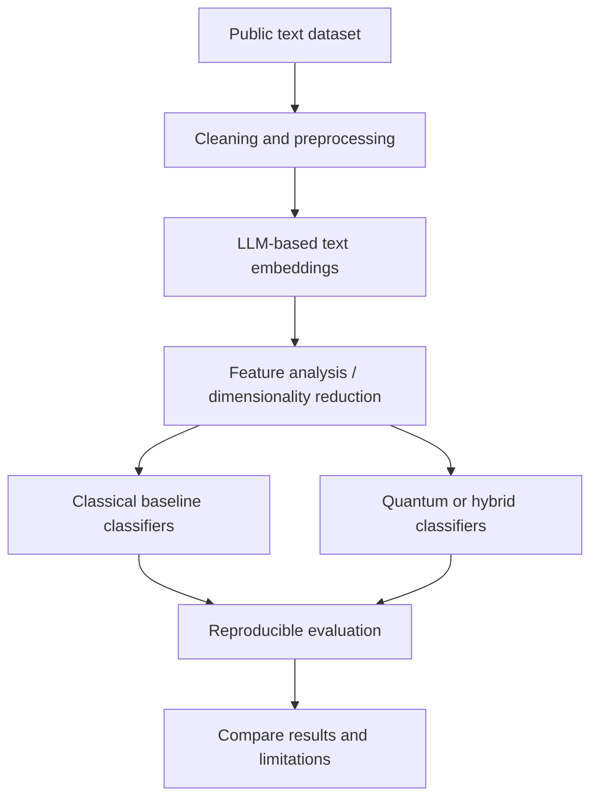

# Quantum Computing, AI & Large Language Models

**Author:** Avenash V  
**Academic profile:** 2nd Year B.Tech — Software Product Engineering (SPE)  
**Institution:** Kalvium × VELS  
**Status:** Ongoing learning and research

A research and learning repository exploring the intersection of **quantum computing, artificial intelligence (AI), machine learning (ML), and large language models (LLMs)**.

The repository builds from quantum-computing fundamentals through quantum machine learning, then connects classical AI/ML and LLM techniques to research questions involving text representation and classification.

> **Research direction:** investigate text classification at the intersection of LLMs and quantum machine learning. A planned experimental path is to create text embeddings using an LLM, apply preprocessing and dimensionality reduction where appropriate, and compare classical classifiers with quantum or hybrid quantum-classical classifiers using reproducible evaluation.

This is an evolving student research repository. It documents concepts, mathematics, papers, diagrams, code examples, datasets, and experiments as they are studied and validated.

---

## Research areas

| Area | Scope | Status |
|---|---|---|
| **Quantum foundations** | Classical information, quantum physics, qubits, superposition, measurement, entanglement | Learning notes through entanglement |
| **AI & LLMs** | AI fundamentals, NLP, language models, tokenization, embeddings, model evaluation | To be expanded |
| **Machine learning** | Classification, feature engineering, dimensionality reduction, evaluation | To be expanded |
| **Quantum machine learning** | Quantum kernels, QSVM, quantum KNN, QNNs, hybrid quantum-classical models | Literature review and foundations |
| **Research experiments** | LLM-based text embeddings and classical vs quantum/hybrid classification | Planned |

## Repository structure

```text
QuantumBlockchain__Research/
├── README.md
├── quantum/
│   ├── README.md
│   ├── 01-classical-computing/
│   ├── 02-quantum-physics/
│   ├── 03-qubits/
│   ├── 04-superposition/
│   ├── 05-quantum-measurement/
│   └── 06-quantum-entanglement/
├── ai/
│   ├── fundamentals/
│   ├── neural-networks/
│   ├── natural-language-processing/
│   ├── large-language-models/
│   ├── embeddings/
│   └── experiments/
├── machine-learning/
│   ├── fundamentals/
│   ├── supervised-learning/
│   ├── unsupervised-learning/
│   ├── dimensionality-reduction/
│   ├── model-evaluation/
│   └── experiments/
├── quantum-machine-learning/
│   ├── README.md
│   ├── fundamentals/
│   ├── quantum-feature-maps/
│   ├── quantum-kernels/
│   ├── quantum-svm/
│   ├── quantum-knn/
│   ├── quantum-neural-networks/
│   └── hybrid-models/
├── research/
│   ├── README.md
│   ├── problem-statement/
│   ├── literature-review/
│   ├── text-classification/
│   ├── methodology/
│   └── experiments/
├── examples/
│   ├── python/
│   ├── notebooks/
│   └── visualizations/
├── datasets/
│   ├── README.md
│   └── processed/
├── assets/
│   ├── images/
│   ├── diagrams/
│   └── charts/
├── references/
└── notes/
```

## Quantum foundations: current learning boundary

The `quantum/` directory follows this learning sequence:

1. Classical computing and binary information
2. Introduction to quantum physics
3. Qubits and state representation
4. Quantum superposition
5. Quantum measurement and the Born rule
6. Quantum entanglement

The current foundational study ends at entanglement. Quantum gates, circuits, algorithms, and hardware will be added in a later stage as they are studied.

## Quantum machine learning

Quantum machine learning (QML) studies how quantum information processing can be integrated with machine-learning methods. This repository will distinguish between:

- **Quantum-enhanced classical ML:** a quantum component is used within an otherwise classical learning workflow, such as a quantum kernel used by an SVM.
- **Native quantum ML:** the learning model itself is formulated around quantum states and operations, such as quantum neural-network approaches.
- **Hybrid quantum-classical ML:** classical preprocessing or optimization is combined with parameterized quantum computations.

Topics planned for study include quantum feature maps, quantum kernels, QSVM, quantum KNN, quantum neural networks, and hybrid architectures.

## Research direction: LLM embeddings for text classification

The intended experimental workflow is:



The comparison should use consistent dataset splits and clearly documented preprocessing. Evaluation should include suitable metrics such as accuracy, precision, recall, F1-score, confusion matrices, and computational/resource measurements where feasible. The classical baseline must be treated seriously; a quantum approach should not be assumed to be faster or more accurate without evidence.

## Initial literature reference

Devadas, R. M., & T, S. (2025). *Quantum machine learning: A comprehensive review of integrating AI with quantum computing for computational advancements*. **MethodsX, 14**, 103318.

- DOI: [10.1016/j.mex.2025.103318](https://doi.org/10.1016/j.mex.2025.103318)
- The review discusses quantum-enhanced classical ML and native QML, including SVM, KNN, and quantum neural networks.
- It surveys concepts such as quantum feature mapping, distance metrics, circuit design, and hybrid quantum-classical architectures.
- It identifies challenges including noise, hardware limitations, scalability, training cost, and encoding classical data into quantum systems.

This paper is a starting point for the literature review, not proof that QML universally outperforms classical ML. Its findings and cited studies should be critically checked before being used to justify an experiment.

## Documentation and experiment standards

- Explain concepts before using advanced notation; define all mathematical symbols.
- Give substantial topics their own Markdown pages.
- Include diagrams and visual references with attribution and licence details.
- Cite primary research papers, standards, books, and official documentation.
- Record dataset source, licence, preprocessing, splits, model settings, random seeds, software versions, and evaluation metrics.
- Separate simulation results from results obtained on quantum hardware.
- Report limitations, resource costs, and negative results as well as positive findings.
- Do not claim quantum advantage unless the experiment supports that claim under a fair comparison.

## Author

**Avenash V**  
2nd Year — B.Tech Software Product Engineering (SPE)  
Kalvium × VELS  

[GitHub profile](https://github.com/Avenash005)

---

*An evolving learning and research repository. Content is added progressively as concepts are studied, implemented, and reviewed.*
