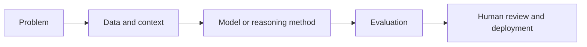

# Artificial Intelligence

This section collects structured notes and practical experiments about artificial intelligence: systems designed to perform tasks involving perception, prediction, language, planning, or decision support.

## Learning roadmap
1. AI terminology, history, and problem formulation
2. Search, logic, and knowledge representation
3. Neural networks and deep learning
4. Natural language processing
5. Large language models and embeddings
6. Retrieval-augmented generation and tool use
7. Evaluation, safety, bias, and limitations

## AI system workflow

## AI and machine learning

AI is the broader field. Machine learning is one approach within AI in which a model learns patterns from data rather than relying only on hand-written rules. Not every AI technique is machine learning.

Record model/version, data or prompt context, evaluation method, and known failure modes for each experiment. Verify generated outputs before presenting them as facts.
