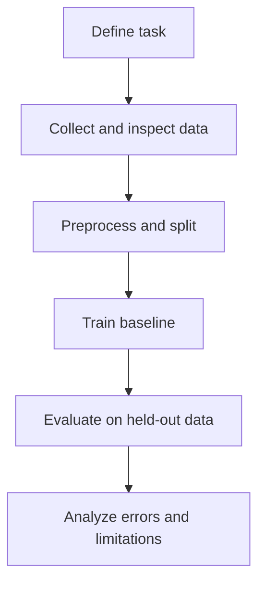

# Machine Learning

This section documents machine learning concepts, algorithms, and reproducible experiments. Machine learning studies methods that learn patterns from data to make predictions or discover structure.

## Learning roadmap
1. Problem formulation and data types
2. Data cleaning and preprocessing
3. Features, labels, and train/test splits
4. Supervised learning: regression and classification
5. Unsupervised learning: clustering and dimensionality reduction
6. Model evaluation and validation
7. Overfitting, regularization, and generalization
8. Experiment tracking and reproducibility

## Typical supervised-learning workflow

## Evaluation notes

Choose metrics according to the task and class balance. For classification, accuracy alone can be misleading; consider precision, recall, F1-score, confusion matrices, and calibration where appropriate. Keep test data separate from model selection.

## Experiment record template
- Research question:
- Dataset and source:
- Preprocessing:
- Baseline:
- Model and hyperparameters:
- Train/validation/test split:
- Metrics:
- Results:
- Limitations:
- Environment and package versions:

A future research direction may compare classical machine-learning methods with quantum or hybrid approaches. Such comparisons require matched datasets, splits, preprocessing, baselines, and evaluation protocols.
