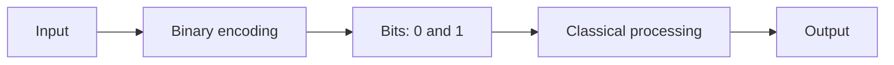

# 01 — Classical Computing and Information

Classical digital computers represent information using bits. A bit takes one of two values, conventionally written as 0 or 1. Groups of bits encode numbers, text, images, instructions, and other data.

## Key concepts
- **Bit:** a binary unit with value 0 or 1.
- **Binary representation:** expressing values using powers of two.
- **Boolean logic:** operations such as AND, OR, and NOT.
- **Information processing:** transforming data according to instructions.

## Example: decimal 13 in binary
\[
13 = 8 + 4 + 1 = 1101_2.
\]

## Classical information flow

## Preview: classical bit vs qubit

A classical bit is in one definite logical state, 0 or 1. A qubit is described by a quantum state that can involve amplitudes for both computational basis states. It is not simply a classical bit that secretly stores both values.

## Questions
- How do logic gates transform bits?
- What makes classical information easy to copy?
- Which classical intuitions do not carry over to quantum states?
