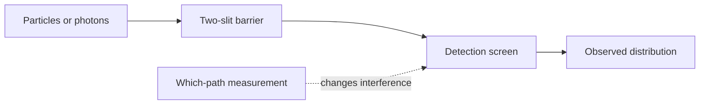

# 02 — Introduction to Quantum Physics

Quantum mechanics is the physical framework used to describe matter and radiation at atomic and subatomic scales. It represents physical systems using mathematical states and predicts measurement outcomes probabilistically.

## Topics
- Classical physics and quantum physics
- Wave-particle duality
- The double-slit experiment
- Probability amplitudes and interference
- Quantum states and observables

## Wave-particle duality

Experiments show that light and matter can exhibit both wave-like and particle-like behaviour. The observed pattern depends on the experimental arrangement and what information is measured.

## Double-slit experiment: conceptual outline

When coherent alternatives are not distinguished by which-path information, probability amplitudes can interfere. Obtaining which-path information changes the interference pattern.

## Important distinction

In situations with interference, amplitudes are combined first; probabilities are then obtained from squared magnitudes. This differs from simply adding classical probabilities.

## Further study
- Superposition and interference
- Quantum state vectors
- Measurement and the Born rule

Add sourced experimental images to `assets/images/` and diagrams to `assets/diagrams/`.

## Visual reference: double-slit experiment

*Diagram: Theodore Xu, via Wikimedia Commons, [CC BY-SA 4.0](https://creativecommons.org/licenses/by-sa/4.0/). [Source and attribution](https://commons.wikimedia.org/wiki/File:Double_Slit_Experiment_-_Simplified_Diagram.jpg).*
