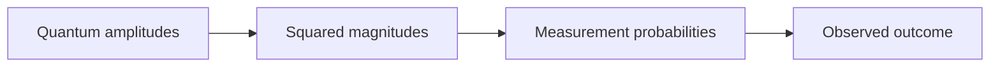

# 04 — Quantum Superposition

Superposition is a feature of quantum-state descriptions in which a state can be expressed as a linear combination of basis states.

For a qubit:

\[
|\psi\rangle = \alpha|0\rangle + \beta|1\rangle,
\qquad |\alpha|^2 + |\beta|^2 = 1.
\]

The coefficients are amplitudes, not ordinary probabilities. The probabilities for measurement in the computational basis are the squared magnitudes of the amplitudes.

## Example: equal-amplitude state

\[
|+\rangle = \frac{1}{\sqrt{2}}(|0\rangle + |1\rangle).
\]

A computational-basis measurement gives 0 and 1 with probability 1/2 each.

## What superposition does not mean
- It does not mean a measurement reveals both outcomes at once.
- It is not simply a classical bit with an unknown value.
- It does not remove the need to specify a measurement basis.

## Amplitudes to probabilities

## Study checklist
- Understand linear combinations.
- Apply normalization.
- Distinguish amplitude from probability.
- Explain interference qualitatively.
