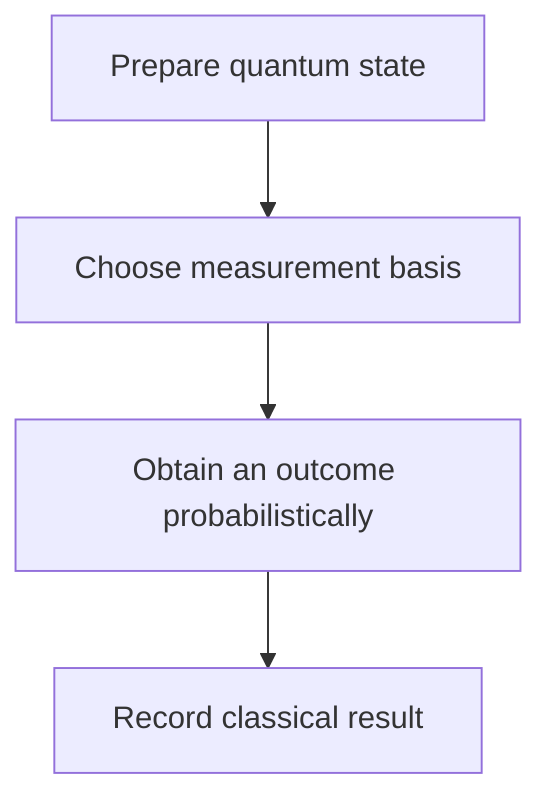

# 05 — Quantum Measurement

A quantum measurement produces a classical outcome. The possible outcomes and their probabilities depend on the quantum state and the chosen measurement.

For a state

\[
|\psi\rangle = \alpha|0\rangle + \beta|1\rangle,
\]

a computational-basis measurement gives:

\[
P(0)=|\alpha|^2, \qquad P(1)=|\beta|^2.
\]

This probability rule is called the **Born rule**.

## Example

For \(|+\rangle=(|0\rangle+|1\rangle)/\sqrt{2}\), outcomes 0 and 1 each have probability 1/2 in the computational basis.

## Measurement flow

## Important cautions
- Probabilities describe statistics across repeated preparations; one run gives one outcome.
- Measurement is not merely reading a hidden classical value.
- State update depends on the measurement model and outcome.
- Projective measurement is an important starting point, not the only measurement formalism.

## Questions
- What is an observable?
- What is a measurement basis?
- How does the state update after measurement?
